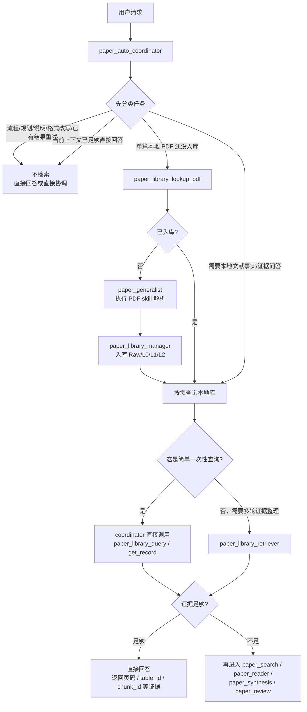
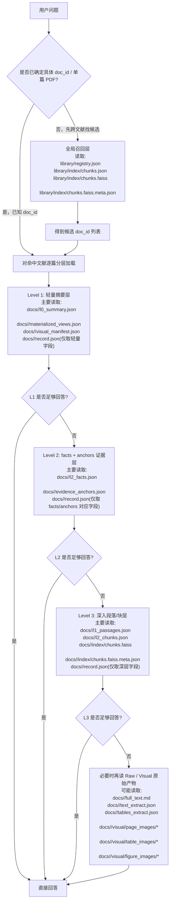

# paper-research-workflow

运行配置、默认值、生效时机和权限说明见 [CONFIG.md](CONFIG.md)。

本地 `paper-pdf-reader` skill 及其旧版 PDF/ODL 辅助脚本已移除。

当前 `paper_research_workflow` 仍以论文检索、阅读编排、卡片保存与综合分析为主链路。

当前还提供 Workspace 级 Paper Wiki：

- Wiki 是 Paper Library/EvidenceStore 的可编辑知识投影，不替代论文原文；冲突时以论文原文为准。
- 新论文入库后可自动生成待审核 Proposal，只有用户在“文献 Wiki”界面批准后才会写入正式页面。
- 用户可以编辑 Markdown、结构化 Claim、别名和实体类型；每次保存都会产生 Revision，可回滚、软删除和恢复。
- Proposal 支持按页面字段和单条 Claim 部分批准；不满意时可一键让受限 LLM 生成替代 Proposal，仍需人工审核。
- 外部 Markdown 可自动 Reconcile 回数据库；搜索采用 SQLite FTS5 + 可降级的 FAISS 向量混合召回。
- Agent 采用 `搜索少量摘要 -> 读取少数页面 Claims -> 按需回到原始证据` 的渐进方式，禁止把整个 Wiki 塞入上下文。
- 普通问答默认只读，不自动沉淀；综合 Agent 只能提交 Proposal，不能批准或应用。

完整设计、使用、运维和更新记录见 [`docs/wiki`](../../docs/wiki/README.md)。

当前额外支持一个工作区级本地文献库：
- 对同一篇本地 PDF 先做查重，已入库则直接复用
- 未入库时只有在用户明确要求“入库/保存到本地文献库/保存到本地数据库/force_reindex”，或经过 `question` 确认后，才解析并入库；如果只是临时分析，则走 PDF 解析/阅读流程，不写入本地库
- 团队内先查本地文献库，再决定是否继续外部检索、稳定阅读和综述
- 文献库采用显式分层：
  - Raw：原始 text/table/full_text 产物
  - L0：文献级摘要，用于粗召回
  - L1：段落或局部单元梗概，用于缩小范围
  - L2：开放 facts + chunk/table evidence，用于精确回答
- 默认 chunk 支持跨页，并通过 `plugins.json` 中的 `library_*` 参数调节长度、overlap 和查询阈值
- 当本地文献库证据不足时，是否自动继续进入 `paper_search / paper_reader / paper_synthesis / paper_review`，由 `plugins.json` 中的 `library_auto_escalate_on_insufficient_evidence` 控制

对于单篇本地 PDF：
- 优先由 `paper_generalist` 作为执行型成员加载 `pdf` skill，并按 skill 中明确给出的脚本流程处理正文、表格和必要的页图
- `paper_library_manager` 负责本地 PDF 查重和已确认保存后的入库；保存意图不明确时由 coordinator/generalist 先向用户确认
- `paper_library_retriever` 负责先查本地文献库并返回证据定位
- `paper_reader`、`paper_synthesis` 继续负责阅读、归纳和回答

对于 ZIP、目录、批量 PDF ingest：
- 仍不在 paper 团队内硬做，应通过专门的批量导入流程或外部工具处理

历史单 PDF 入库冒烟脚本已清理；当前入库使用上述团队流程。文献库 API 的正式回归从仓库根目录运行：
```bash
python -m pytest tests/test_paper_library_api.py -q
```






