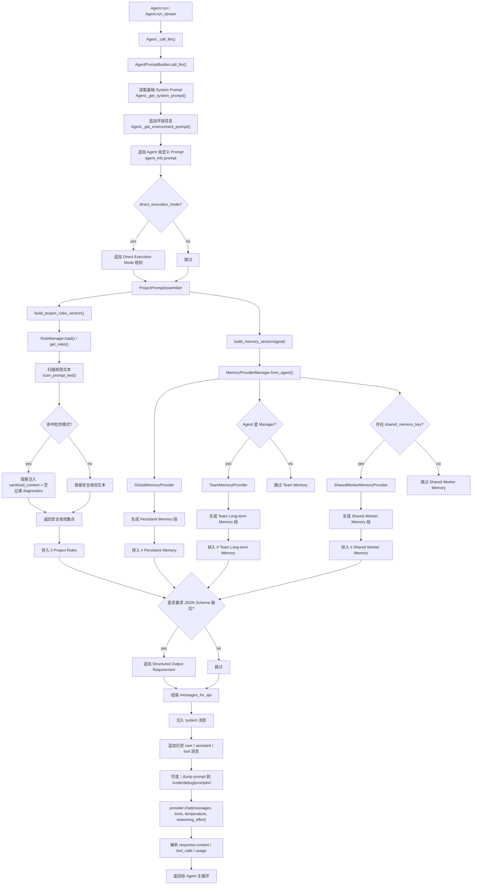

固定系统提示词正文位于 `templates/*.md`，由 `templates.py` 使用包资源加载。
模型选择与动态环境仍由 `agent/agent.py` 和 `harness/prompt_builder.py` 组装。
修改方式、打包规则和验收边界见 [系统提示词Markdown迁移.md](../../docs/上下文/系统提示词Markdown迁移.md)。

| 维度 | 原先的 Prompt 组装 | 现在的 Prompt 组装 |
|---|---|---|
| 组装入口 | 主要分散在 `Agent` 本体里，边判断边拼接 | 收口到 `harness/prompt_builder.py`，`Agent` 只做委托 |
| 核心职责划分 | `Agent` 同时管 prompt、工具、执行流程、部分运行时规则 | Prompt 组装、工具执行、主循环开始分层 |
| 项目规则注入 | 读取规则文件后基本直接使用 | 先经过 `prompt/security.py` 扫描，再由 `RuleManager` 注入 |
| 规则文件安全性 | 默认信任本地规则文本 | 命中注入/覆盖/欺骗模式会被 block，不进入 prompt |
| Rule 文件来源 | 规则来源存在，但管理较松散 | 统一由 `RuleManager` 处理 `AGENTS.md / CLAUDE.md / .cursor/rules.md` |
| Memory 注入方式 | 更偏零散、调用处驱动 | 统一走 `MemoryProviderManager`，按 provider 注入 |
| 支持的 Memory 类型 | 主要是“有 memory 就加” | 明确区分全局 memory、team memory、shared worker memory |
| 运行时模式注入 | 多数靠 Agent 内部条件分支 | 在 Prompt Builder 里有正式注入位，例如 `direct_execution_mode` |
| JSON Schema 输出要求 | 可能散在调用点附近 | 统一在 Prompt Builder 里追加 `Structured Output Requirement` |
| 历史消息格式化 | 更贴近 Agent 内部逻辑 | 统一在 Prompt Builder 中转成 provider 需要的消息格式 |
| Provider 调用前的最终收口 | 不够集中，调试时不容易看全量输入 | 统一在 `call_llm()` 里形成完整 `messages_for_api` |
| 调试能力 | 能看，但不够体系化 | Prompt dump 对应最终组装结果，更适合排查问题 |
| 可测试性 | 改一处 prompt 容易影响 Agent 其他行为 | 可以单测规则加载、规则扫描、memory section、prompt 组装 |
| 可扩展性 | 新加一类 prompt 规则常要改 `Agent` 多处 | 新增规则层/运行模式/记忆段更容易挂进统一入口 |
| 风险控制 | 本地规则文件可能直接污染 system prompt | 增加了 prompt/rule 安全扫描这一道闸门 |
| 维护成本 | 随着团队、插件、模式变多，会越来越粘 | 更适合继续扩展团队、execution profile、worker 模式 |
| 最本质变化 | “Agent 自己拼 prompt” | “Prompt 组装成为独立层，并加了安全边界” |
