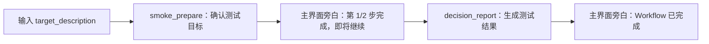
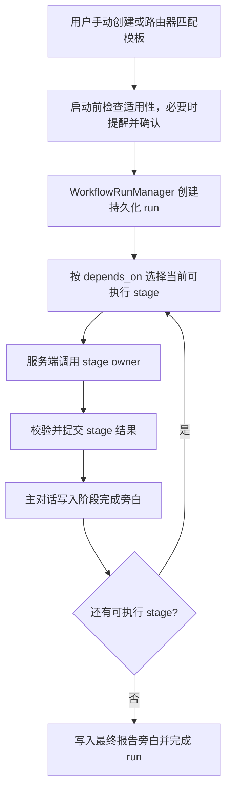

# Workflow 开发说明

Workflow 的源码由“模板、运行时、服务端编排、前端展示”四部分组成。不要直接修改 `.tcode/workflow/runs/*.json`：这些文件只是运行中的状态快照。

完整架构见 [WORKFLOW_ARCHITECTURE.md](../../docs/WORKFLOW_ARCHITECTURE.md)，模板字段见 [workflow模板参数说明.md](../../docs/workflow模板参数说明.md)。

业务扩展请遵循 [新增 Workflow：只修改自己的插件](../../docs/WORKFLOW_PLUGIN_EXTENSION.md)。发现依据注册的能力描述；宿主不为每个插件添加领域关键词或输入解析。

## 当前模板

模板注册器会同时发现包内 `tcode_agent/workflow/templates/*.json` 和 `tcode_agent/workflow/templates/<template_key>/workflow.json`。

当前内建模板有两个；插件声明的模板随安装／重载加入同一注册目录：

| 模板 | 状态 | 用途 |
| --- | --- | --- |
| [workflow_smoke_test.json](templates/workflow_smoke_test.json) | 启用、禁止自动启动 | 两步最小测试，验证步骤衔接、主界面旁白和最终报告 |
| [protein_design_loop/workflow.json](templates/protein_design_loop/workflow.json) | 禁用、禁止路由、禁止创建 run | 保留完整的 8 步目录式模板与独立 prompt 文件，供开发参考 |

禁用模板仍可通过 `WorkflowTemplateRegistry.list_templates(include_disabled=True)` 查看，但普通模板列表不会展示它，`WorkflowRunManager.create_run(...)` 也不能用它创建 run。

## 最小测试流程



在 Workflow 管理界面选择“Workflow 最小测试”，输入任意测试目标后手动创建并运行即可。它不会因普通聊天内容被自动启动，也不会调用外部工具。

## 平台维护：内建模板示例

以下展示内建模板格式，不是业务插件的扩展入口。平台维护者可在 `tcode_agent/workflow/templates/` 下新增 JSON；插件作者将同样格式放到自己 Manifest 声明的 `workflows` 目录，不修改宿主源码：

```json
{
  "template_key": "my_workflow",
  "display_name": "我的 Workflow",
  "domain": "general",
  "enabled": true,
  "description": "说明这个流程解决什么问题。",
  "input_contract": {
    "required": ["target_description"],
    "optional": []
  },
  "output_contract": {
    "required": ["final_report"],
    "optional": []
  },
  "stages": [
    {
      "stage_id": "prepare",
      "depends_on": [],
      "label": "准备输入",
      "owner": "build",
      "call_type": "agent",
      "description": "整理用户输入。"
    },
    {
      "stage_id": "decision_report",
      "depends_on": ["prepare"],
      "label": "生成报告",
      "owner": "build",
      "call_type": "agent",
      "description": "生成最终报告。"
    }
  ],
  "metadata": {
    "version": "1.0.0",
    "routing": {
      "enabled": true,
      "auto_start": false
    }
  }
}
```

需要为每一步维护较长提示词时，使用目录式模板：

```text
tcode_agent/workflow/templates/my_workflow/
├── workflow.json
└── prompts/
    ├── prepare.md
    └── decision_report.md
```

在 stage 中设置 `"prompt_file": "prepare.md"`，注册器会从 `metadata.prompt_dir`（默认 `prompts`）加载内容。

## 运行链路

适用性只在创建运行实例前检查：工具调用、聊天自动路由和管理面板复用同一检查器，
结合原始问题、模板用途和阶段能力判断是否匹配。不确定或不适用时，在启动前说明已知限制并询问是否继续。
启动后不再进行整体或步骤适用性判断，也不再因此暂停等待用户；阶段结果中的限制应在最终回答中说明。
必需输入、工具故障、阶段校验和模板明确声明的人工审核仍按既有规则处理。

旧版本遗留的运行中适用性确认等待，会在续跑时解除并保留历史原因及已完成步骤；用户已经拒绝或取消的实例不会因此自动恢复。



当前执行器按依赖关系逐 stage 推进；模板可以表达 DAG 依赖，但服务端尚未并发执行多个 ready stage。

## 常用修改入口

- 模板发现、校验和启停：[registry.py](registry.py)
- run 状态、持久化和阶段迁移：[manager.py](manager.py)
- 自动路由：[router.py](router.py)
- 缺失输入补问：[clarifications.py](clarifications.py)
- workflow 工具与续跑：[workflow_run.py](../tools/builtin/workflow_run.py)
- stage 执行和 API：[app.py](../server/app.py)
- 主界面旁白：[workflow_presenter.py](../server/workflow_presenter.py)
- 前端面板：[WorkflowWorkspacePanel.tsx](../../web/src/components/WorkflowWorkspacePanel.tsx)

修改模板后至少验证：模板能被注册器加载；禁用模板不能创建 run；stage 依赖无环且引用存在；测试 workflow 能从第一步推进到最终报告；主对话旁白不会重复写入。
